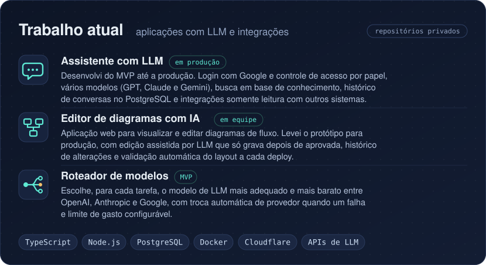
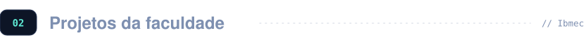
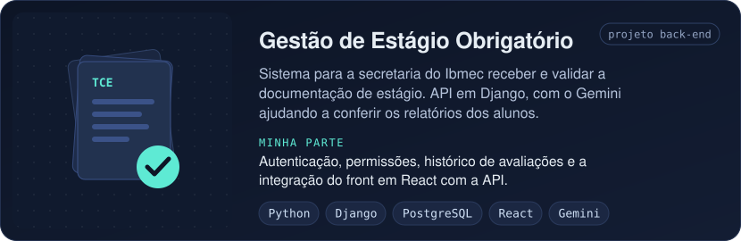
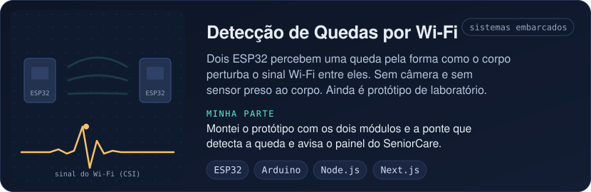
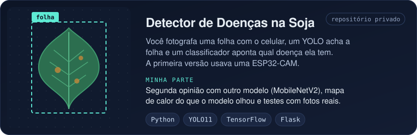

 

Oi! Sou o Otto, estudante de Engenharia de Software no Ibmec. Hoje trabalho como desenvolvedor criando aplicações com LLM, integrações e automações. Nas horas vagas, tenho estudado cibersegurança.

 

 

  
  

  

 

